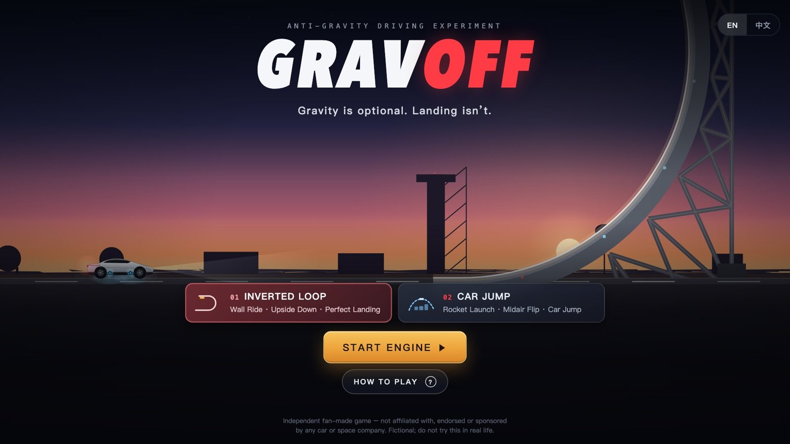
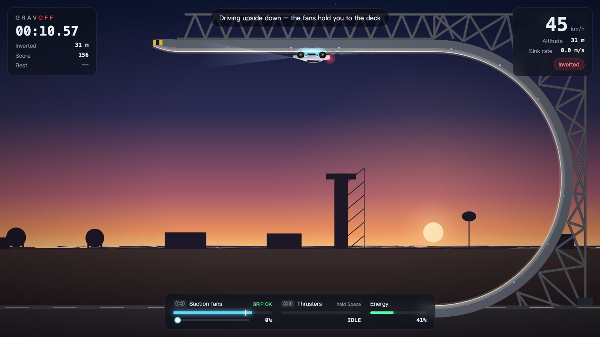
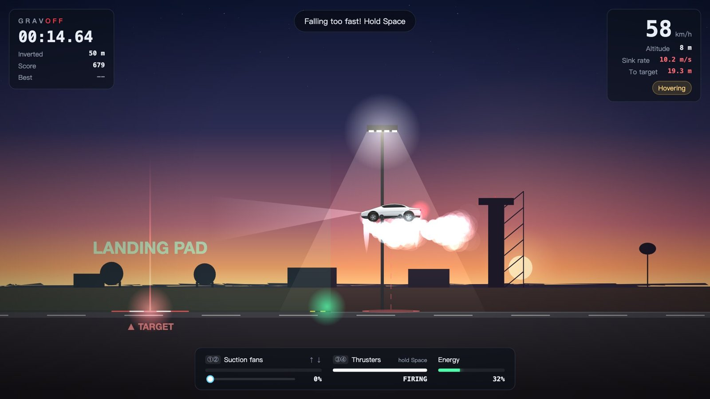
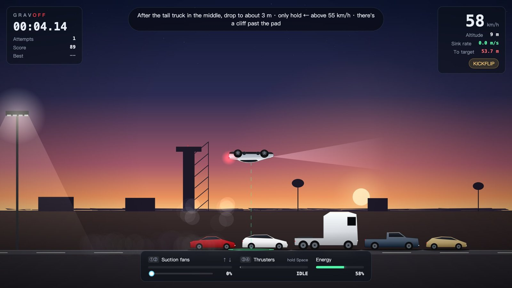
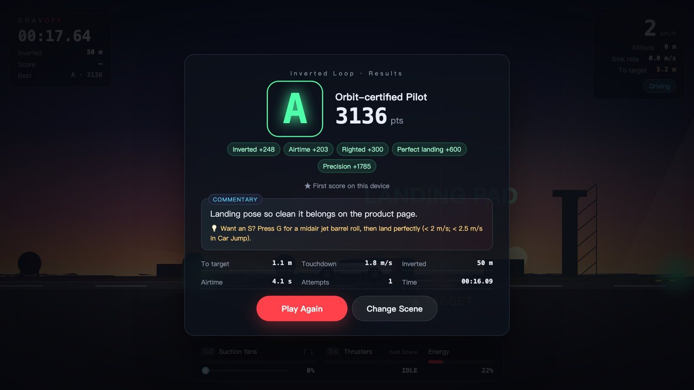
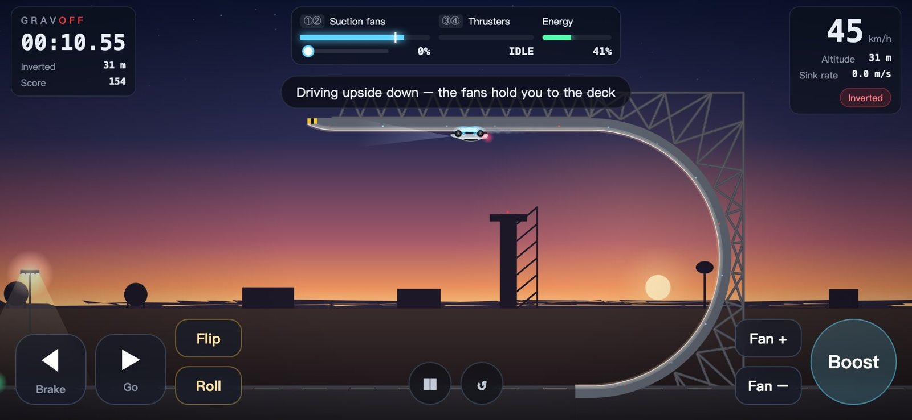
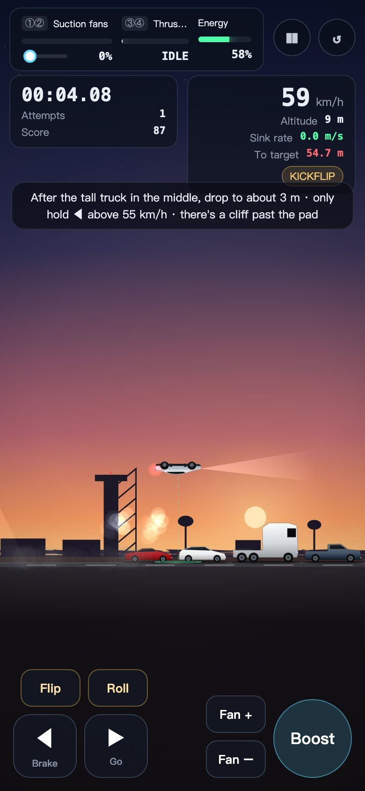

# GRAVOFF

[](README.md)
[](README.zh-CN.md)
[](LICENSE)

[](https://foudreai.com)

**Gravity is optional. Landing isn't.**

A tiny browser game about a sports car with suction fans and cold-gas thrusters: drive upside down, fly over a row of cars, and land on the target. Plain JavaScript + Canvas, no build step, no dependencies. Works on desktop and on phones (portrait or landscape).



## Run locally

Requires [Node.js](https://nodejs.org/) 18+ (or Python 3, or just a browser).

```bash
git clone https://github.com/weijt606/gravoff.git
cd gravoff
npm start            # → http://localhost:8080
```

Other ways:

- `python3 -m http.server 8080 -d public`, then open http://localhost:8080
- Or open `public/index.html` directly in your browser

Use another port with `PORT=3000 npm start`. The game runs entirely in your browser; best scores are saved in local storage.

## How to play

### Your car

| Device | What it does |
|---|---|
| **Suction fans** | Pull the car onto whatever surface it touches – that's how it sticks to a ceiling. The white line on the fan bar is the minimum power needed right now. Stay above it, but more fan burns more energy. On the ground, fans also add grip and help you stop. |
| **Thrusters** | Hold to lift off, hover and slow your descent. They automatically flip an upside-down car back upright. |
| **Energy** | Shared by fans and thrusters. Run out midair and you're just a very expensive rock. |

Hints at the top of the screen always tell you what to do next.

### 01 · Inverted Loop

1. Accelerate into the giant half-loop. Keep the fans on the white line: low in the dip, 75%+ once you're upside down.
2. Drive along the inverted deck – every metre upside down scores.
3. Fly off the end, press Space to flip upright, and add a jet barrel roll (G) for style.
4. Free-fall, then from about 15 m hold Space to brake. Land softly on the pad, as close to the target as you can.

<p>
  
  
</p>

### 02 · Car Jump

1. The thrusters are locked until the yellow TAKEOFF line. Hit it at 45–60 km/h and hold Space.
2. Stay at about 5–6 m over the five parked cars. The truck in the middle is the tallest. Press F for a kickflip.
3. After the truck, drop to about 3 m, then touch down past the last car.
4. You score once the car stops: brake (←) and turn the fans up for grip. Stop on the target, before the cliff.



### Scoring

| | Points |
|---|---|
| Inverted distance (Inverted Loop) | 5 per metre |
| Clearing all cars (Car Jump) | 1000 |
| Airtime | 50 per second |
| Righted / kickflip / jet barrel roll | +300 / +500 / +700 |
| Soft landing / perfect landing | +300 (< 4 m/s) / +600 (< 2 m/s, or < 2.5 m/s in Car Jump) |
| Landing on the pad | 600, plus up to 1400 more the closer you are to the target |
| Energy left (Car Jump) | 5 per % |

A hard landing, landing upside down or rolling off the cliff halves your score. Grades go **D → C → B → A → S → SS**. S and SS also need a jet barrel roll **and** a perfect landing. Every result comes with a cheeky one-line review and a tip for next time.



## Controls

| Key | Action |
|---|---|
| → / ← | Accelerate / brake (reverse thrust in the air) |
| ↑ / ↓ | Fan power (Q off, E max) |
| Space | Thrusters (hold) |
| F / G | Kickflip / jet barrel roll |
| R / P / M | Retry / pause / mute |

**Phones and tablets** show on-screen buttons in both portrait and landscape:
- Left thumb: ◀ ▶, plus Flip and Roll, so your right thumb can keep holding Boost.
- Right thumb: Boost and Fan ±.
- Slide between ◀ and ▶ without lifting your thumb.
- ❚❚ pauses (sound on/off is in the pause menu) and ↺ retries.
- The game pauses itself when you switch apps.

<p>
  
  
</p>

The interface follows your browser language (English / 中文).

## Project structure

```
public/          the whole game (open index.html)
  js/            physics, rendering, scoring, 8-bit music, i18n
tools/           local server and physics simulators (npm run sim:loop / sim:kick)
docs/images/     pictures used in this README
```

## License

[MIT](LICENSE). All code, graphics and music are original to this project.

## Disclaimer

- GRAVOFF is an independent, non-commercial fan game. It is not affiliated with, authorised, sponsored or endorsed by any car, aerospace or technology company.
- The vehicles, "suction fans", "cold-gas thrusters" and physics are fictional and simplified. They do not represent any real product. **Do not attempt any driving or flying shown in the game in real life.**
- Result commentary only teases your in-game performance and does not target any real person, company or group.
- The software is provided "as is", without warranty of any kind (see [LICENSE](LICENSE)).
