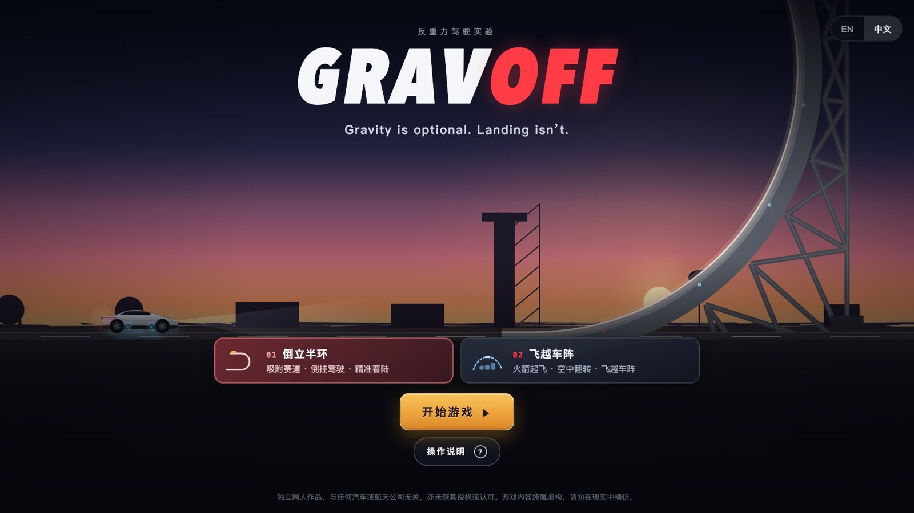

# GRAVOFF

[](README.md)
[](README.zh-CN.md)
[](LICENSE)

**重力可选，落地必修。**（Gravity is optional. Landing isn't.）

一个小小的浏览器游戏：一辆装了吸附风扇和冷气推进器的跑车，倒挂行驶、飞越车阵、精准落在目标点上。纯 JavaScript + Canvas，不需要构建，没有任何依赖。电脑和手机（横屏、竖屏）都能玩。



## 本地运行

需要 [Node.js](https://nodejs.org/) 18+（或者 Python 3，或者只用浏览器）。

```bash
git clone https://github.com/weijt606/gravoff.git
cd gravoff
npm start            # → http://localhost:8080
```

其他方式：

- `python3 -m http.server 8080 -d public`，然后打开 http://localhost:8080
- 或者直接用浏览器打开 `public/index.html`

换端口：`PORT=3000 npm start`。游戏完全在浏览器里运行，最佳成绩保存在本机。

## 玩法

### 你的车

| 装置 | 作用 |
|---|---|
| **吸附风扇** | 把车吸在接触的路面上，所以能倒挂在天花板上行驶。风扇条上的白线是当前需要的最低功率：不要低于白线，但开得越大越耗能。在地面上，风扇还能增加抓地力，帮你刹停。 |
| **推进器** | 按住起飞、悬停、减缓下降；车底朝上时会自动把车翻正。 |
| **能量** | 风扇和推进器共用。半空中耗尽，你就是一块很贵的石头。 |

屏幕上方会实时提示下一步该做什么。

### 01 · 倒立半环

1. 加速冲上巨型半环。风扇跟着白线调：弯底调低，倒挂段开到 75% 以上。
2. 沿着倒置路面倒挂行驶，倒挂的每一米都算分。
3. 冲出尽头后按空格翻正，再来一个喷气侧滚（G）。
4. 先自由下落，离地约 15 m 时按住空格减速，轻轻落在停机坪上，越靠近目标点分越高。

<p>
  
  
</p>

### 02 · 飞越车阵

1. 到黄色 TAKEOFF 线之前推进器是锁定的。以 45–60 km/h 冲过起飞线，按住空格起飞。
2. 在 5 辆车上方保持 5–6 m 高度，中间的重卡最高。按 F 做一个 Kickflip。
3. 越过重卡后降到约 3 m，过了最后一辆车再落地。
4. 车停稳才结算：按 ← 刹车并开大风扇增加抓地力，停在目标点上，别冲下悬崖。


### 计分

| | 分数 |
|---|---|
| 倒挂距离（倒立半环） | 每米 5 分 |
| 越过全部车辆（飞越车阵） | 1000 |
| 滞空时间 | 每秒 50 分 |
| 翻正 / Kickflip / 喷气侧滚 | +300 / +500 / +700 |
| 平稳着陆 / 完美着陆 | +300（< 4 m/s）/ +600（< 2 m/s，飞越车阵 < 2.5 m/s） |
| 落在停机坪上 | 600，离目标点越近最多再加 1400 |
| 剩余能量（飞越车阵） | 每 1% 5 分 |

硬着陆、车底朝上落地或冲下悬崖，分数减半。评级从低到高是 **D → C → B → A → S → SS**；S 和 SS 还要求有喷气侧滚**并且**完美着陆。每局结束都有一句调侃点评和一条下次的建议。


## 操作

| 按键 | 作用 |
|---|---|
| → / ← | 加速 / 刹车（空中为反推） |
| ↑ / ↓ | 风扇功率（Q 关闭，E 全开） |
| 空格 | 推进器（按住） |
| F / G | Kickflip / 喷气侧滚 |
| R / P / M | 重来 / 暂停 / 静音 |

**手机和平板**会显示屏幕按钮，横屏和竖屏都适配：
- 左手：◀ ▶，加上翻转和侧滚，这样右手可以一直按住推进。
- 右手：推进和风扇 ±。
- ◀ 和 ▶ 之间可以按住直接滑动切换，不用抬手。
- ❚❚ 暂停（暂停菜单里可以开关声音），↺ 重来。
- 切到别的应用时游戏会自动暂停。

<p>
  
  
</p>

界面语言跟随浏览器（English / 中文）。

## 项目结构

```
public/          整个游戏（打开 index.html 即可）
  js/            物理、渲染、计分、8-bit 音乐、多语言
tools/           本地启动脚本和物理模拟器（npm run sim:loop / sim:kick）
docs/images/     README 用到的图片
```

## 许可证

[MIT](LICENSE)。所有代码、图形和音乐均为本项目原创。

## 免责声明

- GRAVOFF 是独立开发的非商业同人游戏，与任何汽车、航天或科技公司均无关联，未获得其授权、赞助或认可。
- 游戏中的车辆、"吸附风扇""冷气推进器"和物理效果均为虚构和简化，不代表任何真实产品。**请勿在现实中模仿游戏中的任何驾驶或飞行行为。**
- 结算点评只是对游戏表现的调侃，不针对任何真实人物、公司或群体。
- 本软件按"现状"提供，不提供任何形式的担保（见 [LICENSE](LICENSE)）。
